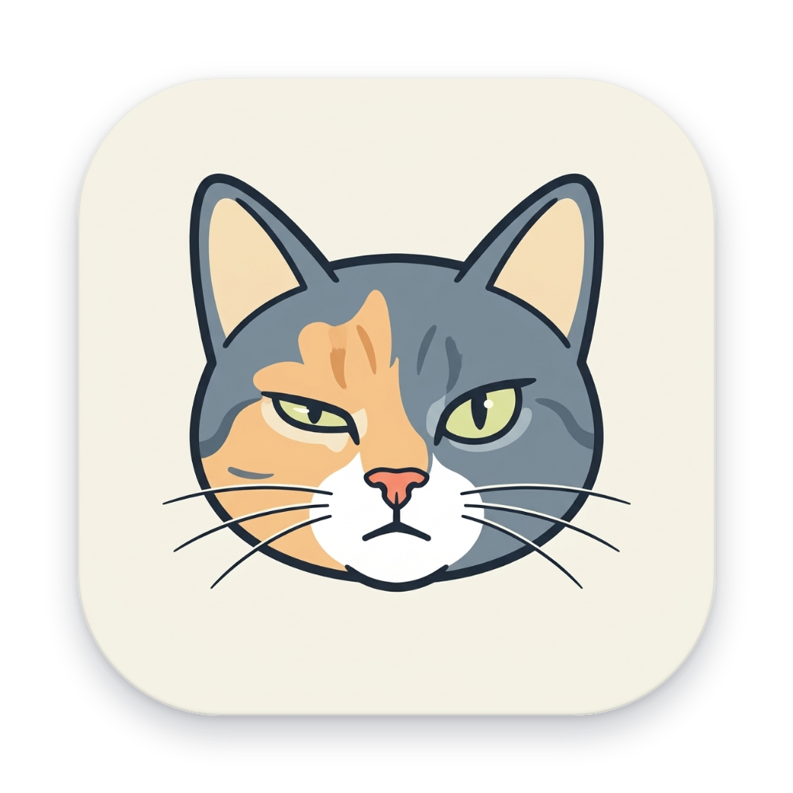
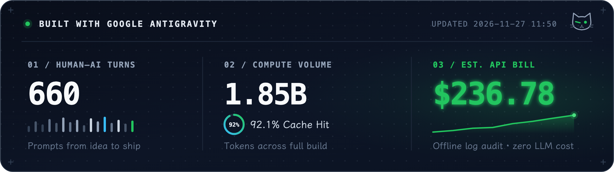
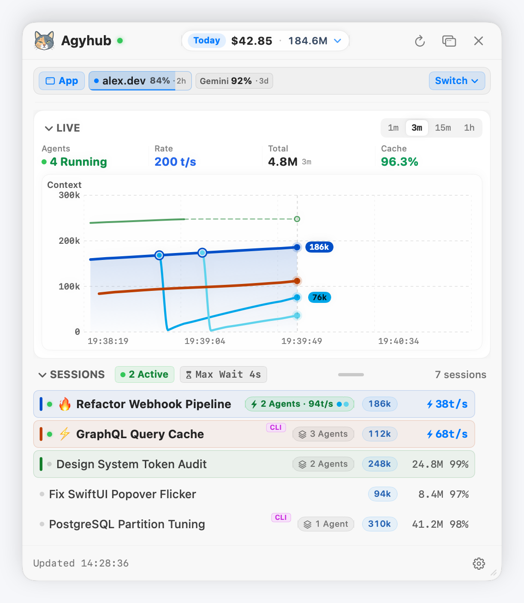
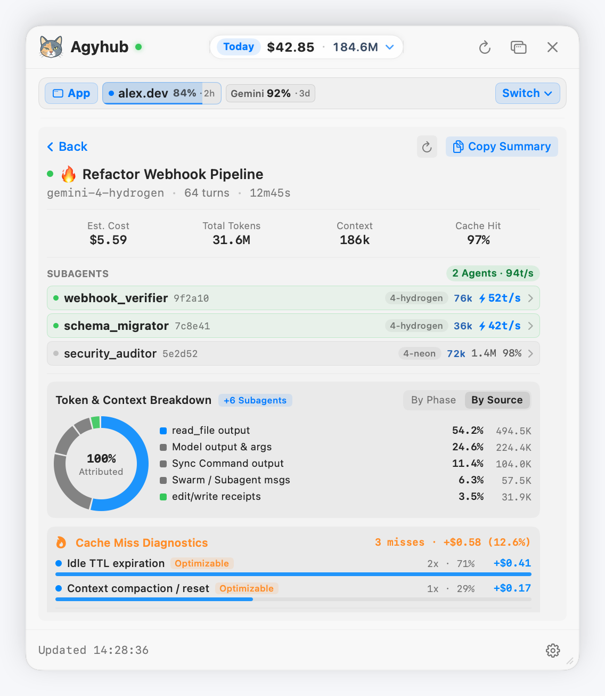
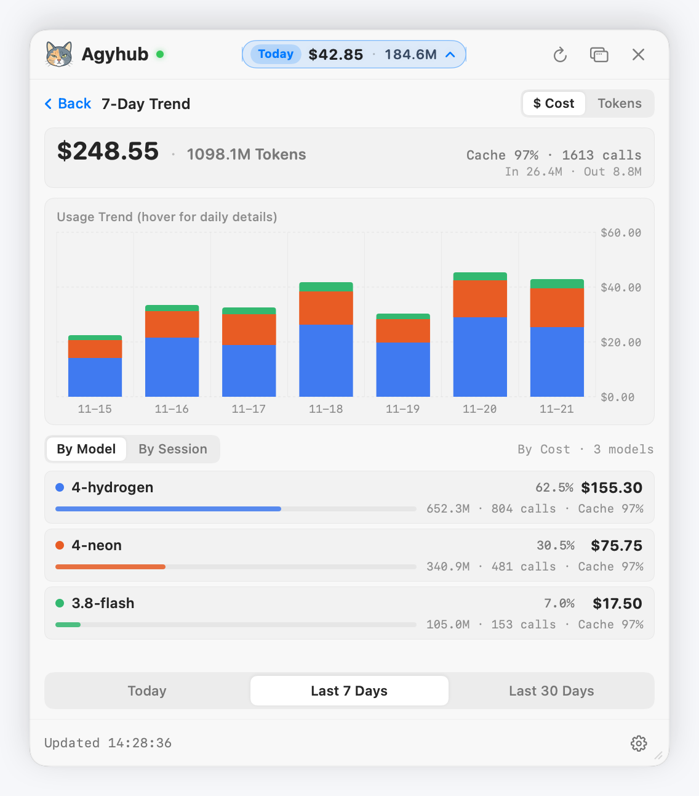

<p align="center">
  
</p>

<h1 align="center">Agyhub</h1>

<p align="center">
  <strong>Native macOS Menu Bar companion for Antigravity — no extra login, 100% local data, safe native account switching & code-driven cache/token analytics.</strong>
</p>

<p align="center">
  English | <a href="./README.zh-CN.md">简体中文</a>
</p>

<p align="center">
  
  
  
</p>

> **A quick note:** This is a personal project shaped out of my own heavy daily use, built end-to-end with **Hakimi** (*Chinese netizens' affectionate nickname for Google Gemini—a playful phonetic pun on "Gemini" blended with the viral "Hakimi" cat meme*). I make no promises that it works in every quirky setup (other than mine), no promises of quick issue replies, and no promises I won't rewrite half of it on a whim—only that I use it every single day, and keep it restrained, transparent, and focused on what matters. If it fits your workflow, take it and enjoy; if anything feels off, just tell your agent to change it—and if it turns out great, feel free to bring it back here.

<p align="center">
  
</p>

---

## Screenshots

<p align="center">
  
  <br />
  <em>Live Dashboard: header <code>Today</code> bill pill, single-row App/CLI switcher with 5h/weekly quota bars, live multi-agent context telemetry with parent-to-child fork trails &amp; OKLCH color families, and a resizable split session list.</em>
</p>

<table>
  <tr>
    <td align="center" width="50%">
      
      <br />
      <em>Running subagent speed, context source attribution donut &amp; cache-miss cost diagnostics.</em>
    </td>
    <td align="center" width="50%">
      
      <br />
      <em>7-day stacked usage trend with per-model &amp; per-session cost/token breakdown.</em>
    </td>
  </tr>
</table>

## Features

- **No Extra Login, 100% Local Data**  
  Never asks for your password or sends session logs to any third-party server. Everything runs locally on your Mac.
- **Native Account Switching, Zero Ban Risk**  
  Built purely on Antigravity's official credential mechanisms. No proxies, no binary patching, no hook injection. Desktop (`Antigravity.app`) and CLI (`agy`) credentials stay cleanly isolated so background refreshes never overwrite your active desktop session.
- **Live Multi-Agent Context Telemetry**  
  Real-time context curves (`1m / 3m / 15m / 1h`) with parent-to-child subagent fork markers, consistent OKLCH color families across ranges, bidirectional chart-to-session highlighting, and an adjustable split pane.
- **Code-Driven Cache Miss & Token Analytics (No LLM Required)**  
  Deterministic local log parsing—zero extra token cost, instant results, and 100% reproducible. Pinpoints prompt cache invalidation causes, calculates wasted cost, and breaks down token usage and spend across sessions, sub-agents, and models.
- **Weekly & 5-Hour Quota Overview**  
  Monitor 5-hour sliding capacity, remaining weekly quotas, and reset countdowns across your accounts directly from a compact single-row bar.
- **Bilingual UI (English / 简体中文)**  
  Follows your macOS system language automatically, with instant in-app switching between English and Simplified Chinese.
- **Lightweight Native Footprint, Low Background Overhead**  
  Incremental local log caching and event-driven menu bar updates keep background CPU and memory usage minimal.

## Requirements

- **macOS 13.0+** (Apple Silicon & Intel)
- **Python 3** (pre-installed on macOS or via Homebrew)
- **Xcode Command Line Tools** *(only needed if building from source)*

## Installation

### Option 1: Download Installer (Recommended)

1. Download the latest `Agyhub-v*-universal.dmg` from [GitHub Releases](https://github.com/meifans/agyhub/releases).
2. Open the `.dmg` and drag **Agyhub.app** into **Applications**.
3. Launch **Agyhub** from Applications or Spotlight.

> **First-launch note (unsigned app):** Because the release binary is ad-hoc signed without Apple notarization, macOS Gatekeeper may block the first launch. Run the following once in Terminal (or allow it in **System Settings → Privacy & Security**):
> ```bash
> xattr -cr /Applications/Agyhub.app
> ```

### Option 2: Build from Source

```bash
git clone https://github.com/meifans/agyhub.git
cd agyhub
./build_app.sh
open ./Agyhub.app
```

To build a Universal Binary (Apple Silicon + Intel) and package a `.dmg` installer locally:

```bash
./build_app.sh --universal --dmg
```

## Development & Testing

```bash
# Run Swift tests
swiftc -DAGYHUB_TESTING Sources/*.swift tests/AGYHubTests.swift \
  -parse-as-library \
  -sdk "$(xcrun --show-sdk-path --sdk macosx)" \
  -target "$(uname -m)-apple-macos13.0" \
  -framework SwiftUI -framework AppKit -framework Security -framework ServiceManagement \
  -o /tmp/agyhub_tests && /tmp/agyhub_tests && rm -f /tmp/agyhub_tests

# Run Python tests
python3 tests/test_agy_monitor.py

# Regenerate bilingual Retina README screenshots from live SwiftUI views
./scripts/generate_screenshots.sh
```

For repository layout and module navigation, see [INDEX.md](INDEX.md). For architectural details, see [ADR-001 (App/CLI Credential Isolation)](docs/adr/ADR-001-cli-app-account-isolation.md) and [ADR-002 (Low-Overhead Incremental Monitoring)](docs/adr/ADR-002-low-overhead-incremental-monitoring.md).

## License & Disclaimer

Released under the [MIT License](LICENSE).

Agyhub is an independent, unofficial community tool and is not affiliated with or endorsed by Google or Antigravity. It performs local read-only log analysis and uses standard OS/native environment mechanisms without modifying official binaries or routing traffic through third-party proxies.
