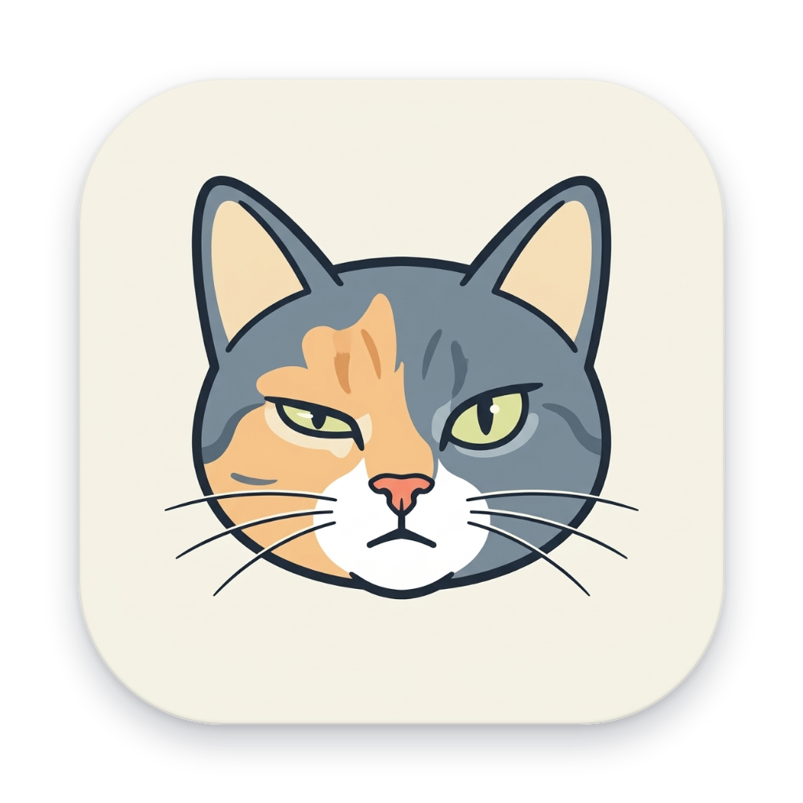
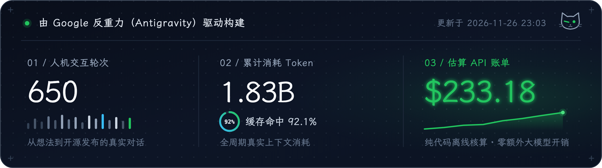
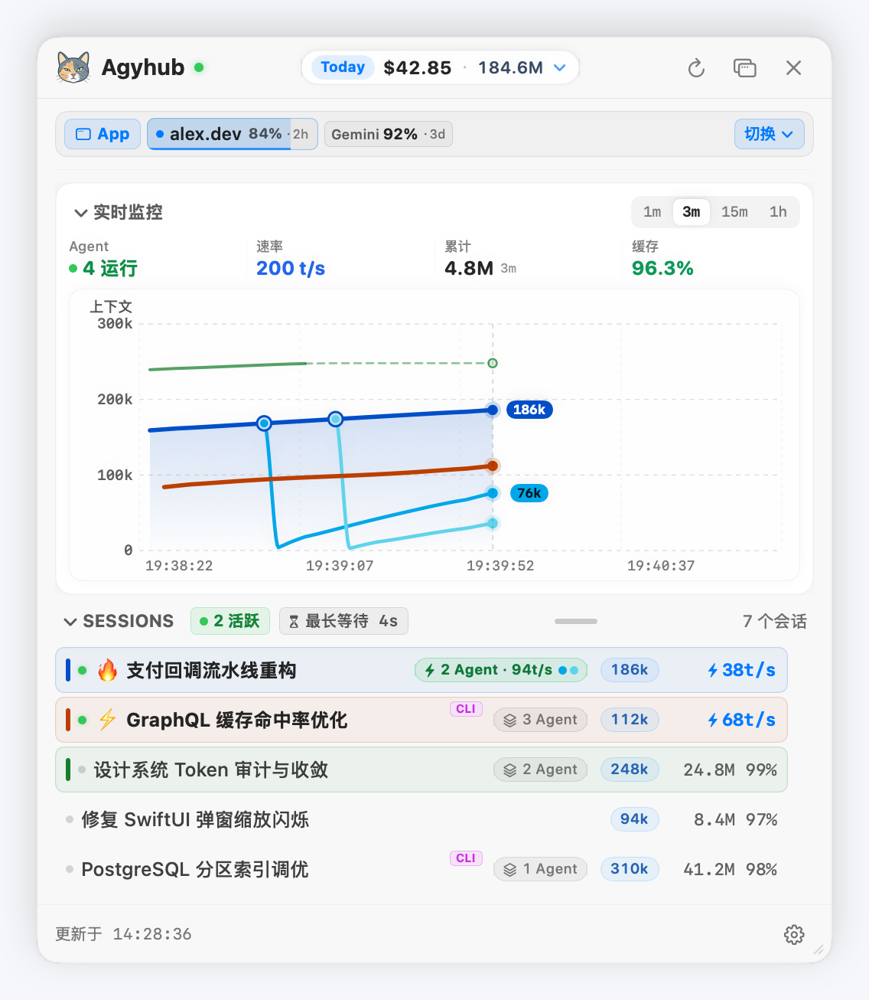
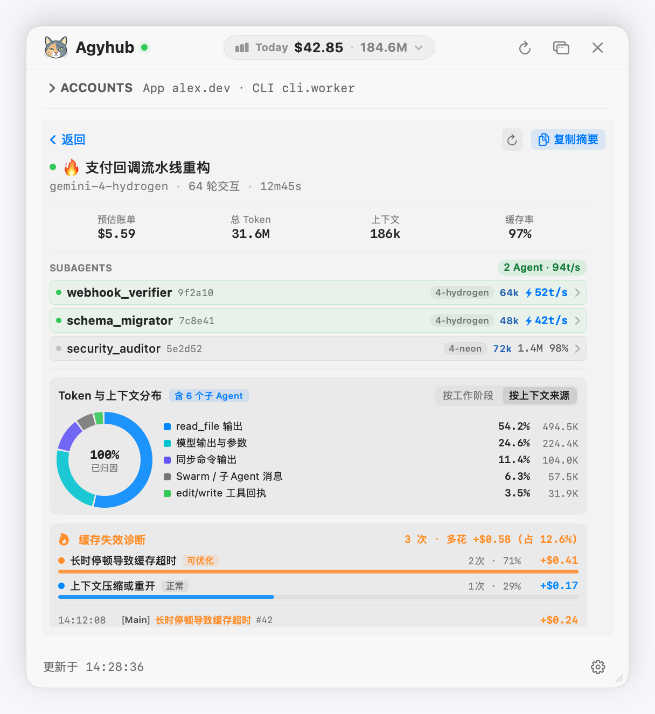
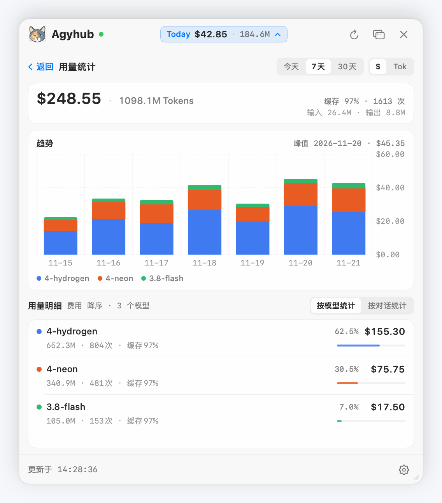

<p align="center">
  
</p>

<h1 align="center">Agyhub</h1>

<p align="center">
  <strong>面向 macOS 的 Antigravity 原生菜单栏助手 —— 无需额外登录、数据全留本地，提供官方原生安全切号与纯代码驱动的缓存失效及 Token 分析。</strong>
</p>

<p align="center">
  <a href="./README.md">English</a> | 简体中文
</p>

<p align="center">
  
  
  
</p>

> **写在前面**：这是一个由我自己在日常重度使用中顺手打磨出来的个人项目，全程由**哈基米**（国内网友对 Google Gemini 的爱称——源于 “Gemini” 的中文谐音与二次元“哈基米”猫咪热梗）协作完成。我不保证它能适配所有人的奇怪环境（除了我的以外），不保证及时响应 Issue，也不保证明天不会心血来潮推翻重写——但它是我每天都在真实使用的工具，克制、透明，只做该做的事。如果刚好合用，欢迎拿去；哪里用着不顺手，直接让你的 Agent 改掉就是——改出好东西了，也欢迎带回这里。

<p align="center">
  
</p>

---

## 界面预览

<p align="center">
  
  <br />
  <em>实时主面板：顶部 <code>Today</code> 账单胶囊、单行 App / CLI 账号与 5 小时/周度配额、多 Agent 实时上下文与分叉轨迹曲线（OKLCH 分族配色），以及支持拖拽调节的会话列表。</em>
</p>

<table>
  <tr>
    <td align="center" width="50%">
      
      <br />
      <em>子 Agent 实时速率监控、上下文来源占比环图与缓存失效多花费用诊断。</em>
    </td>
    <td align="center" width="50%">
      
      <br />
      <em>近 7 天堆叠消耗趋势，支持按模型 / 按对话多维度切分费用与 Token。</em>
    </td>
  </tr>
</table>

## 核心特性

- **无需额外登录，数据 100% 留在本机**  
  不要求输入账号密码，不向任何第三方服务器上传日志或凭证，全部计算与存储均在本地完成。
- **官方原生切号与额度查询，零封号风险**  
  完全基于 Antigravity 官方原生凭证机制与官方 `agy -p "/usage"` 命令工作，不调内部私有 API、不反代、不中转、不魔改客户端、不注入 Hook。将桌面端（`Antigravity.app`）与 CLI（`agy`）账号凭证物理隔离，支持一键切换，杜绝后台续期导致的串号覆盖。
- **实时多 Agent 上下文遥测**  
  支持 `1m / 3m / 15m / 1h` 时间窗实时绘制主/子 Agent 上下文增长与分叉连线（OKLCH 跨时间窗固定色系），支持图表曲线与会话行双向悬停高亮及分栏高度拖拽调节。
- **纯代码驱动的缓存失效与 Token 分析（不依赖大模型）**  
  纯本地只读解析会话日志，零额外 Token 消耗、离线秒出、结果可复现。精准定位 Prompt Cache 失效原因与额外开销，并按会话、子 Agent 和模型维度统计真实的 Token 与费用账单。
- **周度与 5 小时配额一览**  
  通过官方 `agy -p "/usage"` 零消耗只读探测当前活跃 App / CLI 账号的 5 小时滑动余量、周度配额百分比及重置倒计时；被切走的备用账号保留切换前缓存在本地的配额与状态，切回后自动刷新。
- **中英文双语界面（English / 简体中文）**  
  默认跟随 macOS 系统语言，并支持在设置中一键即时切换简体中文与英文。
- **原生轻量，低后台开销**  
  依托本地增量解析缓存与事件驱动的菜单栏按需刷新机制，静默常驻时保持极低的后台开销。

## 为什么不封号：Agyhub 如何避免账号被官方标记

外部第三方客户端如果直接抽取本地 OAuth 凭证去请求 Google 内部私有接口（如 `cloudcode-pa`）、伪造官方 `User-Agent` 或 ACP 客户端身份、或者在后台定时轮询多个备用账号的 Token，行为指纹会与三方反代/号池高度重合，容易触发 Google 官方的账号标记与风控。

Agyhub 在每一条数据链路上都刻意守住**只走官方原生产物、不碰内部私有通道**的边界：

| 能力模块 | Agyhub 实际是怎么做的 | 明确绝不做的红线 |
| :--- | :--- | :--- |
| **额度查询** | 仅通过官方二进制执行 `agy -p "/usage" --output-format json`（强制 `agy >= 1.1.11` 版本门禁、`num_turns == 0` 零 Token 消耗、自动 180 秒冷却），且**只探测当前活跃的 App / CLI 槽位**（CLI 靠 `SSH_CLIENT=1` 隔离）。被切走的备用账号只读本地缓存（`~/.agy-profiles/quota_cache.json`），保留切走前的最后额度与状态，切回后再自动刷新。 | **不**直连 `cloudcode-pa` 等内部私有接口；**不**伪造客户端 `User-Agent`；**不**拆钥匙串里的 Token 自行调 `oauth2.googleapis.com` 续期；**不**在后台轮询或替闲置备用号拉起进程刷额度。 |
| **切号与隔离** | 桌面端沿用系统原生钥匙串，CLI 沿用官方内置的 `SSH_CLIENT=1` 无头模式独立文件（`~/.gemini/antigravity-cli/antigravity-oauth-token`，`0600`），切换时直接拉起官方原生 `Antigravity.app` / `agy`。 | **不**搭建反代中转、**不**修改官方二进制、**不**注入 Hook，**不**篡改 `$HOME` 构造临时号池。 |
| **监控与账单分析** | `agy-monitor.py` 纯离线只读解析本地 SQLite 与会话 JSONL 日志。 | **不**产生任何外部网络请求，**不**消耗任何模型 Token。 |

> 简单理解：**正在用的账号交给官方 `agy` 自己查额度，切走的备用账号留在本地“冻结保留切走前的状态”**——既能看清用量与防串号，又不留下任何三方探针特征。

## 系统要求

- **macOS 13.0+**（支持 Apple Silicon 与 Intel）
- **Python 3**（macOS 自带或 Homebrew 安装）
- **Xcode Command Line Tools** *（仅从源码编译时需要）*

## 安装与使用

### 方式一：下载安装包（推荐）

1. 前往 [GitHub Releases](https://github.com/meifans/agyhub/releases) 下载最新版本的 `Agyhub-v*-universal.dmg`。
2. 打开 `.dmg`，将 **Agyhub.app** 拖入 **应用程序（Applications）** 文件夹。
3. 从应用程序或聚焦搜索启动即可。

> **首次打开提示**：由于开源发布包采用本地 Ad-hoc 签名（未做 Apple 公证），首次打开时若被 macOS Gatekeeper 拦截，在终端执行一次以下命令（或在「系统设置 → 隐私与安全性」中点击「仍要打开」）即可：
> ```bash
> xattr -cr /Applications/Agyhub.app
> ```

### 方式二：从源码编译

```bash
git clone https://github.com/meifans/agyhub.git
cd agyhub
./build_app.sh
open ./Agyhub.app
```

如需在本地打包 Apple Silicon + Intel 双架构 Universal Binary 与 `.dmg` 安装包：

```bash
./build_app.sh --universal --dmg
```

## 开发与测试

```bash
# 运行 Swift 单元测试
swiftc -DAGYHUB_TESTING Sources/*.swift tests/AGYHubTests.swift \
  -parse-as-library \
  -sdk "$(xcrun --show-sdk-path --sdk macosx)" \
  -target "$(uname -m)-apple-macos13.0" \
  -framework SwiftUI -framework AppKit -framework Security -framework ServiceManagement \
  -o /tmp/agyhub_tests && /tmp/agyhub_tests && rm -f /tmp/agyhub_tests

# 运行 Python 单元测试
python3 tests/test_agy_monitor.py

# 一键基于当前 SwiftUI 视图重绘中英双语 Retina 主页宣传图
./scripts/generate_screenshots.sh
```

如需查看仓库目录与源码模块导航，请参阅 [INDEX.md](INDEX.md)；如需了解底层架构设计细节，请参阅 [ADR-001（App 与 CLI 双轨隔离）](docs/adr/ADR-001-cli-app-account-isolation.md) 与 [ADR-002（低开销增量监控架构）](docs/adr/ADR-002-low-overhead-incremental-monitoring.md)。

## 开源协议与免责声明

本项目基于 [MIT License](LICENSE) 开源。

Agyhub 为非官方社区工具，与 Google 或 Antigravity 官方无任何从属关系。所有功能均基于本地只读日志分析与系统原生机制实现，不修改官方程序，也不提供代理或中转服务。
