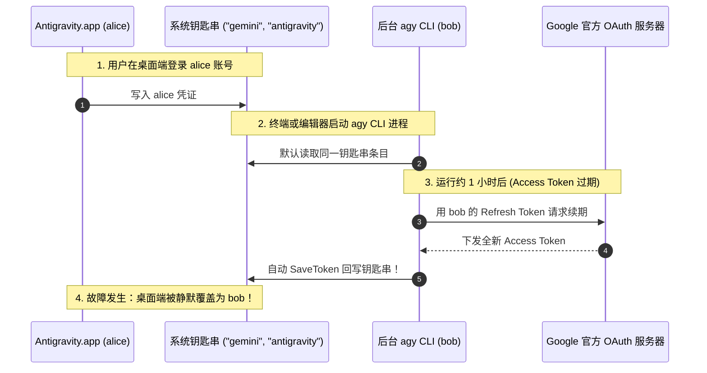
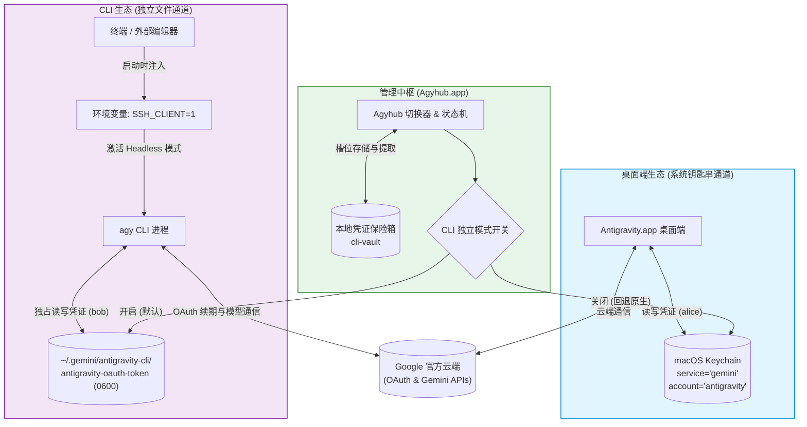
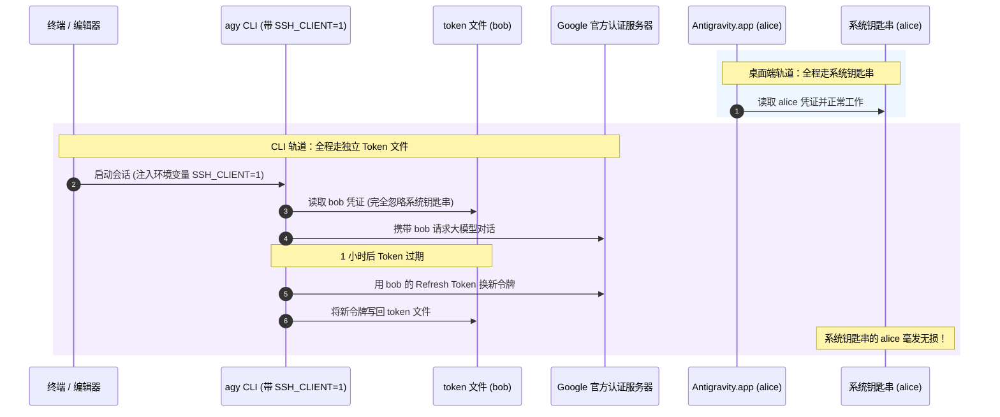

# ADR-001: Antigravity App 与 CLI 账号物理隔离架构决策

- **状态**: Accepted (已实施并全量通过自动化回归测试)
- **日期**: 2026-11-12
- **决策人**: 用户 & Antigravity Agent
- **影响范围**: `Agyhub.app`、`Antigravity CLI (agy)`、`Antigravity.app`

---

## 1. 理解本方案的最小必要知识 (Minimal Essential Knowledge)

为了便于陌生读者快速上手与长期维护，阅读正文前只需了解以下 7 个核心概念：

| 核心概念 | 通俗比喻 | 技术含义与在本方案中的作用 |
| :--- | :--- | :--- |
| **Access Token (访问令牌)** | **门禁临时手环**（保质期 1 小时） | 每次请求大模型时实际携带的凭证。因为只有 1 小时寿命，后台进程必须频繁刷新它。 |
| **Refresh Token (刷新令牌)** | **长期身份证**（长期有效） | 当门禁手环过期后，程序拿着它向 Google 服务器无感换取新手环。保存在钥匙串或 token 文件中的核心就是它。 |
| **macOS Keychain (系统钥匙串)** | **公共储物柜** / 系统保险柜 | macOS 系统提供的安全凭证库。`Antigravity.app` 原生强制依赖它（槽位 `gemini/antigravity`）。 |
| **Headless 模式 (无桌面模式)** | **服务器工作模式开关** | Google 官方为在云服务器、Docker 容器或 SSH 终端运行 `agy` 设计的回退通道。环境变量配置 `SSH_CLIENT=1` 会激活该模式，使 `agy` 改读写本地文件。 |
| **Token 文件 (`antigravity-oauth-token`)** | **CLI 专属私有抽屉** | `SSH_CLIENT=1` 模式下 `agy` 读写凭证的纯 JSON 文件，权限 `0600`，与桌面 App 系统钥匙串物理隔离。 |
| **agy CLI (`agy` / `agy acp`)** | **命令行后台执行端** | 在终端或外部编辑器中调用的 Antigravity CLI 进程，负责执行对话指令并与云端大模型通信。 |
| **Agyhub 保险箱 (`cli-vault`)** | **备用凭证档案室** | Agyhub 在系统钥匙串下创建的独立安全槽位，用于本地秒切账号并在切换前自动保存刷新凭证，防止登录态丢失。 |

---

## 2. 背景与问题定义 (Context & Problem)

在多账号开发场景下，用户希望在同一台 Mac 上同时登录并使用不同账号：
1. **桌面端 `Antigravity.app`** 登录主账号（如 `alice@example.com`）；
2. **命令行 / 编辑器 CLI 端**（通过 `agy` / `agy acp` 进程）使用辅助或工作账号（如 `bob@example.com`）。

### 2.1 触发故障（Bug 现象）
在未改造前，用户在 `Antigravity.app` 中登录好 `alice` 账号后，经过一段时间（约 1 小时内），主应用会自动被“刷”回 `bob` 账号，导致桌面端账号频繁意外偏移。

### 2.2 用人话讲透：之前为什么会打架？（“公共储物柜”冲突）
你可以把 macOS 系统钥匙串 想象成玄关处**唯一的一个公共储物柜**：
- 这个储物柜的名字叫 `("gemini", "antigravity")`；
- 桌面端 `Antigravity.app` 每次登录，都把自己的通行证放进这个柜子；
- 命令行或编辑器后台唤起 `agy` CLI 时，默认也去找这个柜子拿通行证。

问题出在 Google 凭证的“1 小时保质期”：
Google 的访问令牌（Access Token）只有 60 分钟寿命。后台运行的 `agy` CLI 发现令牌快过期了，会自动联系 Google 换一张新的，**换完之后顺手写回了这个公共储物柜**！
结果就是：你在桌面端登录的 `alice`，不知不觉就被后台自动续期的 CLI 给覆写成了 `bob`。

### 2.3 改造前覆写时序拓扑

---

## 3. 探索与方案论证过程 (Exploration Journey)

为了在**不触发账号封禁、不搭建代理中转、不破坏系统稳定性**的前提下解决该问题，我们进行了多轮真机黑盒实测与行为验证：

### 方案 A：更改 `$HOME` 变量（已否决）
- **思路**：通过包装脚本或在子进程前注入 `HOME=~/.agy-profiles/xxx`，让 `security` 访问该目录下的独立 Keychain。
- **实测验证**：运行 `HOME=~/.agy-profiles/cli-bob ~/.gemini/bin/agy models`。
- **副作用拦截**：实测发现，修改全局 `HOME` 不仅改变了钥匙串，更影响了 `agy` 内部的 `os.UserHomeDir()`。导致 CLI 进程在隔离目录下重新生成了 `.gemini/antigravity-cli/conversations/`、`conversation_summaries.db`、全新的 `installation_id`，且下游 MCP 工具创建了隔离的 `.codegraph/`、`.npm/`。这会导致会话历史分裂、设备标识异化、缓存全面失效，**确定不可行，予以否决**。

### 方案 B：伪造 Keyring 不可用标记（已否决）
- **思路**：尝试利用临时缓存标记文件诱导 CLI 绕过系统钥匙串。
- **实测验证**：该类回退仅作为钥匙串临时超时的短期保护机制（约 1 小时失效）且不同子命令路径行为不一致，无法作为稳定的多账号常驻隔离方案，**予以否决**。

### 方案 C：基于 Headless 环境检测的文件 Token 模式（最终采纳）
- **核心发现**：
  官方 `agy` CLI 原生内置了面向远程服务器与容器的无头（Headless）环境检测机制，会依次检查以下标准环境变量：
  - `SSH_TTY`
  - `SSH_CLIENT`
  - `SSH_CONNECTION`
  - `WSL_DISTRO_NAME` / `WSL_INTEROP`
  - 容器环境与无图形会话状态
- **行为特征**：
  一旦命中上述变量（例如环境变量中存在 `SSH_CLIENT=1`），`agy` 会判定当前处于无桌面系统的服务器/SSH 终端环境。
  此时，**`agy` 完全跳过对 macOS Keychain 的读取与写入，直接降级为文件存储模式**：
  - 凭证路径：`~/.gemini/antigravity-cli/antigravity-oauth-token`
  - 存储格式：纯 JSON（标准 OAuth 结构，含 `access_token`、`refresh_token`、`id_token_email`）
  - 权限要求：`0600`（仅当前用户可读写）

- **端到端完整闭环验证 (PoC / Scratch Test)**：
  我们在隔离脚本中模拟 CLI 的后台运行模式：
  1. 将 `bob` 凭证写入 `~/.gemini/antigravity-cli/antigravity-oauth-token`，故意将 `expiry` 篡改为过期时间；
  2. 启动 `SSH_CLIENT=1 agy acp`；
  3. 客户端发送 `initialize`、`session/new`，并发送真实对话 `session/prompt`；
  4. **实测表现**：`agy acp` 正常回复，消耗 token 并自动完成网络刷新；
  5. **实测落盘**：`antigravity-oauth-token` 文件中的 `expiry` 被自动更新为最新，`userinfo` API 确认仍为 `bob@example.com`；
  6. **系统钥匙串检验**：macOS 钥匙串 `("gemini", "antigravity")` 毫发无损，依然为 `alice@example.com`。

---

## 4. 架构设计与实施决策 (Decision)

### 4.1 核心解法：给 CLI 单独分一个抽屉
我们没有修改 Google 的任何二进制文件，也没有搭建第三方代理，而是直接利用官方为远程服务器设计的降级通道：
- **彻底物理隔离**：`Antigravity.app` 独享系统钥匙串，`agy` CLI 独享本地 token 文件；
- **后台自动续期互不干扰**：CLI 在后台无论自动续期多少次，更新的均是 `~/.gemini/antigravity-cli/antigravity-oauth-token` 文件，桌面端系统钥匙串连碰都不会碰；
- **环境绝对干净**：无需更改 `$HOME` 变量，CLI 的会话历史、设备 ID、以及底层的 MCP 工具缓存（npm、codegraph 等）完全维持在系统原生默认路径，零副作用。

### 4.2 系统架构拓扑图 (Architecture Topology)

### 4.3 改造后双轨运行时序图 (Sequence Diagram)

### 4.4 为什么百分之百安全、防封号？
1. **二进制零篡改**：完全使用 Google 官方分发的原版 `agy` 二进制，不打补丁，不做内存 Hook。
2. **零中转 / 零代理**：网络流量直接由 `agy` 与 Google 官方端点通信（`daily-cloudcode-pa.googleapis.com` 等），不存在任何第三方反代服务器。
3. **官方规范行为**：文件 token 模式是官方为 Linux 服务器、Docker 容器和 SSH 远程开发环境设计的标准功能，行为特征与数万名在云服务器使用 agy 的开发者完全一致。

---

## 5. 开关控制与回退机制 (Feature Toggle & Fallback)

为了兼顾不同开发者的使用习惯，Agyhub 在设置中提供了明确的开关：
- **开启独立模式（默认）**：
  - 主面板展示 `App | CLI` 胶囊，可分别切换两端账号；
  - CLI 端读写独立 token 文件，两端账号彻底隔离。
- **关闭独立模式（原生共享模式）**：
  - Agyhub 自动物理清理 `~/.gemini/antigravity-cli/antigravity-oauth-token` 文件，让 `agy` 自动回退为读取系统钥匙串；
  - 主界面隐藏 `App | CLI` 切换胶囊，仅展示常规账号环境列表；
  - 切换任一账号即同步作用于 App 与 CLI。

---

## 6. 自动化测试保障 (Test Coverage)

在 `tests/AGYHubTests.swift` 中固化了端到端回归测试，重点覆盖以下关键不变量与边界条件（具体用例名以测试源码为准）：
- **归属裁决防伪造**：日志心跳 mtime 不得覆盖真实登录时间；登出日志必须覆盖更早登录；后台 CLI 刷新钥匙串与文件模式日志必须准确区分；外部改写钥匙串必须使旧切换锚点失效。
- **凭证落盘与切号安全**：`go-keyring-base64:` 解码为纯 JSON、`0600` 权限与原子写盘、切走前先保住当前账号最新刷新凭证、目标未缓存或当前文件损坏时不丢号不污染保险箱、关闭独立模式自动清理 token 文件。
- **配额与展示规则**：周度配额解析、Ultra 单池折叠、倒计时与多行 Tooltip 格式化，以及 Token 过期缺失 OAuth 时的温和降级提示。

---

## 7. 账号周度额度与重置时间监控架构 (Account Weekly Quota Architecture)

### 7.1 官方 Quota 接口说明
Google 官方在 Antigravity 后台提供了两个核心配额接口：
- `https://daily-cloudcode-pa.googleapis.com/v1internal:retrieveUserQuotaSummary`（聚合型模型组配额，包含 5h 滑动窗口与周度 Weekly 窗口）；
- `https://daily-cloudcode-pa.googleapis.com/v1internal:retrieveUserQuota`（明细模型级配额）。

### 7.2 关键门禁：User-Agent Gating 机制
实测发现官方服务端根据请求头 `User-Agent` 进行分组过滤：
- 若携带旧版或通用 UA（如 `antigravity/1.11.0` 或不带版本号），接口只返回 `Claude and GPT models`（3P 组）；
- 必须携带当前语言服务标准 UA：`antigravity/2.29.0 darwin/arm64`，服务端才会完整返回 `Gemini Models`（`gemini-weekly`）与 `Claude and GPT models`（`3p-weekly`）全量组。

### 7.3 业务裁决与展示规则
1. **普通 / Pro 账号**：分别展示 `Gemini`（G）与 `Argon`（A，包含 Claude 与 GPT 模型组）的周度剩余百分比与重置倒计时（例如 `G 62% ·3d` 与 `A 49% ·6d`）；
2. **Ultra 账号**：因 Google AI Ultra 订阅采用全局共享统一配额池，界面自动折叠，仅保留单一 `Gemini` 额度胶囊（例如 `Gemini 85% ·3d`）；
3. **悬浮详情 (Tooltip)**：移入胶囊展示对应模型的精确说明、当前百分比与具体重置时间；
4. **Token 刷新与过期降级**：Antigravity 桌面端续期通常仅保存在进程内存，不会每小时回写系统钥匙串。因此对**当前活跃 App / 活跃独立 CLI 账号**，当查配额遇到 401 且无外部 OAuth 凭据时，Agyhub 会按冷却节流（30 分钟一次，或用户点击刷新/`Expired` 时立即执行）静默调用官方只读零 Token 命令 `agy models`（独立 CLI 槽位带 `SSH_CLIENT=1`）触发原生续期并立即重拉配额；同时将最近一次成功配额持久化到 `~/.agy-profiles/quota_cache.json`，确保重启 App 后仍保留历史真实配额。长期闲置超过 1 小时的备用账号在默认零密钥状态下被动降级并保留缓存配额，切回该账号时自动更新。

### 7.4 开源零密钥边界与刻意不做的红线

在开源发布与多账号配额刷新这件事上，我们刻意选择了“对当前活跃账号零配置开箱即用，对闲置备用账号守住安全与低开销边界”，明确否决了两种代价过高的方案：

#### 取舍 1：源码零密钥，也不让普通用户手配 OAuth
- **选 A（源码零内置密钥 + 普通用户零配置开箱即用）**：公开仓库与安装包中不内置任何官方或第三方 OAuth Client ID / Client Secret；同时严禁在文档、错误日志或界面引导里要求普通用户手动创建或填写 OAuth JSON。当前活跃账号通过官方只读 `agy models` 自动原生续期，无需任何手工配置。
- **不选 B（源码内置提取出的官方 Client Secret，或在引导/日志中要求用户手动配 OAuth JSON）**：
  1. 在仓库中硬编码官方 Client Secret 会直接触发 GitHub Push Protection 拦截，并带来把官方客户端密钥随开源代码分发的合规与风控风险；
  2. 要求下载 `.dmg` 的普通用户自己去理解 OAuth 凭证并维护本地 JSON 文件，是完全不可接受的产品体验。
- **留白边界**：代码层面仍静默兼容环境变量（`AGYHUB_OAUTH_CLIENT_ID` / `AGYHUB_OAUTH_CLIENT_SECRET`）与 `~/.agy-profiles/oauth_client.json`，仅作为极少数自备凭证开发者的隐式扩展通道，不作为产品前置条件，日志也不得输出引导创建该文件的指令。

#### 取舍 2：活跃账号原生按需续期 vs 严禁为闲置备用账号建临时 `HOME` 代刷
- **面临的盲区**：Google Access Token 只有 1 小时寿命。Antigravity 桌面 App 平时在内存续期，不会每小时回写系统钥匙串；闲置备用账号超过 1 小时也会过期。
- **选 A（活跃槽位官方只读 `agy models` 续期 + 本地缓存持久化 + 闲置备用号被动降级）**：
  1. 当前活跃 App 账号（真实钥匙串）与当前活跃独立 CLI 账号（真实 `cliTokenFile`）在 401 时，由 Agyhub 按 30 分钟冷却或用户主动点击刷新/`Expired` 静默执行官方只读 `agy models`（零 Token、不建临时 `HOME`、不落盘明文凭证），续期后立刻拿回真实配额并持久化到 `~/.agy-profiles/quota_cache.json`；
  2. 长期闲置的备用账号不拉起任何 `agy` 进程，重启后直接展示 `~/.agy-profiles/quota_cache.json` 中保留的上次真实配额。
- **不选 B（在临时 `HOME` 目录注入 `SSH_CLIENT=1` 拉起官方 `agy` 进程替闲置备用账号代刷 Token）**：
  1. 必须把备用账号的 `refresh_token` 明文落盘到临时目录，进程异常退出会留下凭证泄露风险；
  2. 为多个闲置备用账号批量冷启动 200MB+ 的 `agy` 进程会拖垮低开销菜单栏常驻定位；
  3. 临时覆盖 `HOME` 存在击穿未来版本 App/CLI 隔离边界的风险。

> **架构红线（后续维护者与 Agent 必须遵守）**：
> 1. 严禁在源码、测试或打包脚本中硬编码任何官方或第三方 OAuth Client Secret，也严禁在日志或引导中要求普通用户手动创建 `oauth_client.json`；
> 2. 严禁以临时 `HOME` 落盘明文凭证的方式在后台替闲置备用账号批量拉起 `agy` 进程（仅允许对当前活跃 App / 活跃独立 CLI 槽位使用真实路径按冷却或用户点击调用官方只读 `agy models`）。

---

## 8. 桌面端切号回归原生启动决策 (Desktop Switch Native Launch Decision)

### 8.1 故障本质与早期弯路 (Root Cause Analysis)
早期版本试图通过给 Antigravity 传递 `--user-data-dir=~/.agy-profiles/<email>` 参数来实现多账号物理隔离。该设计带来了致命副作用：
1. **Retina 视口与分辨率崩坏**：Electron/Chromium 在独立空目录下缺少系统级视口配置，且被粗暴拷贝的 `Preferences` 带有硬编码的 `per_host_zoom_levels`，导致高分屏（2x Retina）下界面发生二次放大或缩微，红绿灯与字体巨大化；
2. **凭证隔离伪命题**：Antigravity 桌面端的真实 OAuth Token 本身保存在 macOS 系统钥匙串 `("gemini", "antigravity")` 中，目录隔离无法真正阻止钥匙串读写。

### 8.2 终极解决方案 (Production Fix)
1. **单实例切换一律走官方原生启动**：
   - 彻底废弃切换时的 `--user-data-dir` 参数，调用 `/usr/bin/open -n -a /Applications/Antigravity.app`；
   - 统一使用默认数据目录 `~/Library/Application Support/Antigravity`，系统 2x Retina 缩放与视口 100% 保持官方出厂标准；
2. **凭证热写入与安全轮换**：
   - 切换前将当前持有者凭证安全归档回保险箱；
   - 若目标账号在保险箱已有缓存，直接写回共享钥匙串后拉起应用；
3. **隔离目录残留污染自动清理**：
   - 启动前自动扫描并清理所有隔离目录中的单例锁与带 zoom 污染的 `Preferences` 文件，确保环境纯净。
