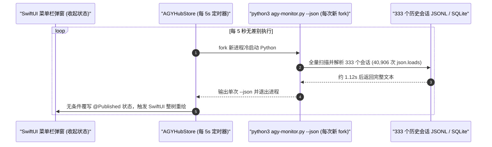
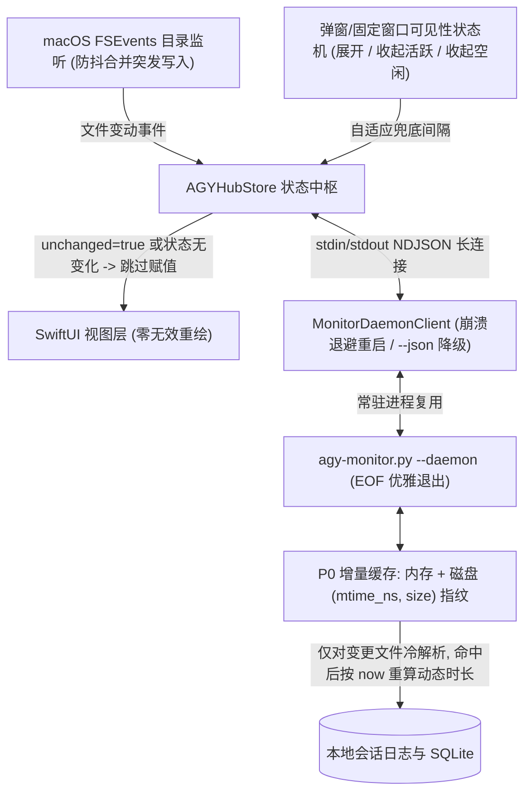

# ADR-002: 低开销增量监控与常驻 Daemon 架构决策

- **状态**: Accepted (已实施、全量集成并通过 68 项 Swift 单测、17 项 Python 单测、Universal 打包与真机性能压测)
- **日期**: 2026-11-21
- **决策人**: 用户 & Antigravity Agent
- **影响范围**: `agy-monitor.py`、`AGYHub.swift` (`AGYHubStore` / `MonitorDaemonClient` / `SessionDirectoryWatcher`)、`tests/test_agy_monitor.py`、`tests/AGYHubTests.swift`

---

## 1. 背景与实测问题 (Context & Problem)

Agyhub 作为常驻 macOS 菜单栏的原生状态栏应用，除了账号隔离与切换外，另一项核心职责是**本地只读监控**：实时展示活跃会话、等待/卡顿时长、Token/费用消耗及 Cache Miss 分析。

### 1.1 优化前实测基线
在真实开发环境（含 **333 个历史会话**）下对原方案进行采样与剖析，暴露出显著的后台空转开销：
- **单次解析耗时**：运行 `python3 agy-monitor.py --json` 单次耗时 **~1.12s**；
- **解析重复度极高**：单次调用触发 **40,906 次 `json.loads`**，其中 **98.6%** 的耗时消耗在 `load_conversations` 全量重扫全部历史会话文件；
- **高频进程冷启动**：Swift 端无论菜单栏弹窗是否打开、数据是否变动，每 **5 秒** 通过 `Process` fork 拉起一次全新的 Python 进程；
- **资源占用基线**：运行中常驻内存（RSS）约 **173MB**，每隔 5 秒产生约 **20% 瞬时 CPU 峰值**。

### 1.2 用人话讲透：为什么原本会这么重？（三大浪费叠加）
把原来的工作方式拆开看，本质上有三层叠加浪费：
1. **硬盘冷读浪费（每次把旧账本全部重抄一遍）**：已经结束几周甚至几个月的 300 多个历史会话文件，一个字节都没变，但每 5 秒还是全部打开、逐行 `json.loads` 重新算一遍。
2. **进程冷启动浪费（每 5 秒重新启动一次引擎）**：每次轮询都要从零 fork Python 解释器、导入标准库模块、扫盘统计、再退出销毁，大量 CPU 消耗在“反复启动和销毁进程”上。
3. **界面盲目重绘浪费（没人看也在全树刷新）**：用户绝大多数时间并未打开菜单栏弹窗，且很多时候没有活跃会话在写入；但 Swift 仍每隔 5 秒强行把整份结果赋给 `@Published` 属性，迫使 SwiftUI 做全量视图树 Diff 与内存重分配。

### 1.3 优化前轮询开销拓扑

---

## 2. 决策与三层架构方案 (Decision & 3-Layer Architecture)

为了把后台静默监控的 CPU 与内存开销降到原生菜单栏应用应有的水准，同时**不引入第三方重依赖、不牺牲数据准确度**，采用由底向上的 **P0 + P1 + P2 三层协同优化方案**：

### 2.1 P0：Python 侧基于 `(mtime_ns, size)` 指纹的内存 + 磁盘增量缓存
- **双层缓存机制**：
  - **进程内内存缓存**：在 `--daemon` 常驻模式下，未变动会话直接零 I/O 命中内存字典；同时为 `_read_subagent_descriptors` 与 `usage_daily_cache.json` 增加签名校验内存缓存，`_load_conversations_from_dir` 复用已查摘要行避免重复打开 SQLite。
  - **轻量磁盘缓存**：落盘于 `~/.cache/agyhub/session_inspect_cache_v1.json`（支持 `AGYHUB_INSPECT_CACHE_PATH` 覆盖路径），采用原子写盘并携带 `schema_version=1`；若缓存文件损坏或版本不匹配，自动静默重建，不报错阻断监控；支持通过环境变量 `AGYHUB_DISABLE_CACHE=1` 强制禁用缓存以便基准对照。
  - **指纹覆盖范围**：基于对话/日志文件的 `(mtime_ns, size)` 以及模型 DB 的 `(mtime_ns, size, wal_mtime_ns, wal_size)` 联合判定是否复用。
- **静态提取与动态重算严格分离（关键正确性红线）**：
  - 缓存条目只记录基于文件内容的**静态解析结果**（如标题、模型、Token 累计、Cache Miss 归因）与原始时间戳 `last_step_created_at`；
  - **严禁将依赖当前时间 `now` 的动态字段固化进缓存**；
  - 每次命中缓存后，必须结合当前的 `now` 与 DB 实时状态现场重算 `current_stall`、`health`、`health_code`、`health_desc` 等相对时长与实时状态，保证缓存命中路径与冷解析路径的语义 100% 一致。

### 2.2 P1：SwiftUI 弹窗可见性感知降频 + 去重防整树重绘
- **可见性感知三态调度（`PollingSchedulePolicy`）**：通过 `AGYAppDelegate.syncActivationPolicy()` 精确追踪 `mainWindow`（菜单栏 Popover）与 `standaloneWindow`（独立固定窗口）的显隐和最小化状态，同步至 `AGYHubStore.isDashboardVisible`：
  1. **界面可见时**：由 `FSEvents` 防抖事件驱动实时更新，兜底轮询为 `max(0.2, refreshInterval)`（默认 **5.0s**）；
  2. **界面收起且存在活跃会话时**：兜底轮询拉长为 `max(refreshInterval, 15.0)`（默认 **15.0s**）；
  3. **界面收起且完全空闲时**：兜底轮询进一步退避为 `max(refreshInterval, 60.0)`（默认 **60.0s**）；
  4. **切回可见瞬间**：立即触发一次即时刷新并恢复正常周期，确保用户打开面板即见最新状态。
- **`etag` / `unchanged` 与展示状态等价去重（`MonitorPayloadEquivalencePolicy`）**：
  - Swift 端在 `snapshot` 请求中携带上次收到的 `etag`（`if_none_match`）；
  - 当 Daemon 返回 `unchanged: true` 时直接跳过 JSON 解码与 `@Published` 赋值；在回退或常规更新路径中，通过 `MonitorPayloadEquivalencePolicy.areDisplayEquivalent` 忽略 `timestamp` 对比关键展示字段（同时为 `refreshCLIAccountState`、`usageHistory`、`recent503Count` 补齐变更守卫），数据未实质变化时**跳过 `@Published` 赋值**，从根源阻断无意义的 SwiftUI 视图树 Diff 与内存分配。

### 2.3 P2：常驻 Python NDJSON Daemon + macOS `FSEvents` 目录防抖监听
- **常驻 `--daemon` 子进程（`MonitorDaemonClient`）**：
  - 以常驻 `python3 agy-monitor.py --daemon --data-dir <dir>` 子进程替代每 5 秒一次的 `Process` fork，通过 stdin/stdout Pipe 按行收发 NDJSON；
  - **生命周期与退出安全**：Swift 端在 `AGYAppDelegate.applicationWillTerminate` 与 `AGYHubStore.deinit` 中关闭 `stdin` 触发优雅 EOF 退出（超时未退再执行 `terminate`/清理）；Python 端检测到 stdin EOF 或 `BrokenPipeError` 时主动干净退出（`exit 0`），杜绝孤儿残留进程；
  - **故障自愈与降级**：若子进程意外退出、管道断开或单次请求超时，客户端自动清理并进入指数退避重启（1s 起步、上限 30s）；在退避或不可用窗口期无缝降级为单次 `--json` / `--recent-503` / `--usage-history` / `--analyze-session` 调用，确保监控绝不中断。
- **macOS `FSEvents` 目录防抖监听（`SessionDirectoryWatcher` + `DebouncedTrigger`）**：
  - 通过 `CoreServices` 的 `FSEventStream`（随 `AppKit`/`Foundation` 自动链接，无需额外 `-framework CoreServices` 编译参数）监听实际存在的 `~/.gemini/antigravity/brain` 与 `~/.gemini/antigravity-cli/brain`（及非统一模式当前 `dataDir`）；对暂不存在的目录保持定期探测并在创建后自动纳管；
  - 内置 **400ms** 防抖窗口（含 `maxCoalesceDelay` 上限防止持续流式写入导致刷新饥饿）合并突发写入，仅在文件真实变动时唤醒增量刷新，彻底摆脱无意义的盲轮询。

---

## 3. 协议契约与权衡取舍 (Protocol Contract & Trade-offs)

### 3.1 `--daemon` NDJSON 通信协议
每条请求与响应均为单行 JSON（以 `\n` 分隔，写后立即 `flush`）：

| 命令 (`cmd`) | 请求示例 | 响应示例 | 说明 |
| :--- | :--- | :--- | :--- |
| `snapshot` | `{"id": 1, "cmd": "snapshot", "if_none_match": "<etag>"}`（支持可选 `target_uuid` / `data_dir` / `anchor_path`） | 命中未变：`{"id": 1, "ok": true, "unchanged": true, "etag": "<etag>"}` 发生变更：`{"id": 1, "ok": true, "unchanged": false, "etag": "<etag>", "payload": {...}}` | 基于剔除 `timestamp` 的稳定业务载荷计算 16 位 SHA-256 hex `etag`；`payload` 与原 `--json` 100% 一致 |
| `recent_503` | `{"id": 2, "cmd": "recent_503"}` | `{"id": 2, "ok": true, "payload": {...}}` | 对应原 `--recent-503` 输出 |
| `usage_history` | `{"id": 3, "cmd": "usage_history"}`（支持可选 `days`） | `{"id": 3, "ok": true, "payload": {...}}` | 对应原 `--usage-history` 输出 |
| `analyze_session` | `{"id": 4, "cmd": "analyze_session", "session_id": "<uuid>"}` | `{"id": 4, "ok": true, "payload": {...}}` | 对应原 `--analyze-session` 输出 |
| `ping` | `{"id": 5, "cmd": "ping"}` | `{"id": 5, "ok": true, "pong": true}` | 健康探活 |
| 单命令异常 | 任意格式或执行错误 | `{"id": ..., "ok": false, "error": "<msg>"}` | 单次异常隔离返回错误，严禁导致 daemon 进程崩溃退出 |

### 3.2 为什么保留 Python 解析引擎，而不是全量用 Swift 重写？
曾评估过将 `agy-monitor.py` 全部重写为原生 Swift 的方案，最终明确否决，理由如下：
1. **避免双端逻辑漂移**：`agy-monitor.py` 同时服务于 `Agyhub.app` 与终端 TUI 工具 `agy-top`，其中包含大量异构 JSONL 容错解析、Prompt Cache 失效归因与模型单价计算逻辑。全量重写会制造两套解析口径，后续任何日志格式适配都要改两次、测两遍。
2. **找准了真正的瓶颈所在**：优化前 1.12s 的瓶颈并不在“Python 语言本身慢”，而在于**“每次全量重读 333 个未变更的历史文件 + 每 5 秒冷启动 fork 进程”**。在引入 `(mtime_ns, size)` 增量缓存与常驻 Daemon 后，未变更会话直接命中内存缓存，已完全消除了 Python 冷启动与历史重复扫描开销。
3. **零额外依赖成本**：`--json` 与 `--daemon` 模式仅依赖 macOS 自带或用户现有的 Python 3 标准库，无需引入第三方构建链或重型外部包。

### 3.3 不可破坏的稳定性红线
1. **动态时间字段零缓存**：任何随 `now` 变化的相对耗时（卡顿时长、空闲时长、运行状态）严禁持久化进缓存，必须每次基于当前时钟重算。
2. **CLI 完全向后兼容**：`--json`、`--recent-503`、`--usage-history`、`--analyze-session` 命令行模式保持既有输出契约不变，同时作为 `--daemon` 不可用时的兜底降级路径。
3. **无孤儿进程**：Daemon 必须监听 stdin EOF 干净退出，App 退出时必须关闭管道并回收子进程句柄。
4. **缓存可自愈且可禁用**：磁盘缓存损坏自动忽略重建，且 `AGYHUB_DISABLE_CACHE=1` 可随时一键关闭缓存用于问题排查与基准对比。

---

## 4. 实测效果对比 (Benchmark Results)

在当前本机真实会话数据（**574 个会话目录**、**15 个最近展示会话**、存在活跃会话）上由独立验收员执行背靠背实测验证，结果如下：

| 测量维度 | 优化前基线（`AGYHUB_DISABLE_CACHE=1 --json`） | P0 优化后（热缓存 `--json`） | P0+P2 优化后（`--daemon` 连续 `snapshot`） | 实测对比与说明 |
| :--- | :--- | :--- | :--- | :--- |
| 单次调用耗时（3~5 次样本） | `1024.80 ms` / `974.85 ms` / `962.02 ms` | `94.18 ms` / `159.76 ms` / `72.51 ms` | `32.43 ms` / `21.64 ms` / `17.25 ms` / `17.57 ms` / `17.68 ms` | 历史早先 333 会话剖面基线为 `~1.12s` / `40,906` 次 `json.loads` |
| 平均响应耗时 | **`987.22 ms`** | **`108.82 ms`** | **`21.31 ms`**（第 2~5 次带 `if_none_match` 均值 **`18.53 ms`**） | P0 提速 **9.1x**（降幅 **89.0%**）；P0+P2 提速 **46.3x**（降幅 **97.8%**） |
| `unchanged: true` 命中表现 | 不适用 | 不适用 | 第 3~5 次命中仅 **`17.25~17.68 ms`** | 跳过 JSON 重解码与 SwiftUI `@Published` 重绘 |
| 进程冷启动开销 | 每 5s fork 一次 Python（运行时 RSS ~173MB / 瞬时 CPU ~20%） | 仍需单次进程启动 | **0 次 fork**（常驻长连接） | 关闭 `stdin` 后以退出码 `0` 干净退出，无残留进程 |
| `--daemon` 其余命令实测 | 每次独立拉起进程 | 复用增量缓存 | `ping` `35.99 ms` / `recent_503` `125.61 ms` / `usage_history` `52.91 ms` / `analyze_session` `37.31 ms` | 单条命令异常隔离返回 `ok: false` |
| 语义一致性与回归测试 | 冷解析基线 | 关键状态 `active_count` / `total_roundtrips` / `has_alert` 与冷解析 100% 一致 | Python **17/17**（`1.373s`）+ Swift **68/68** 全量通过 | `./build_app.sh --universal --dmg --version 1.0.0` 通过（`x86_64 arm64` + `codesign -v`） |
